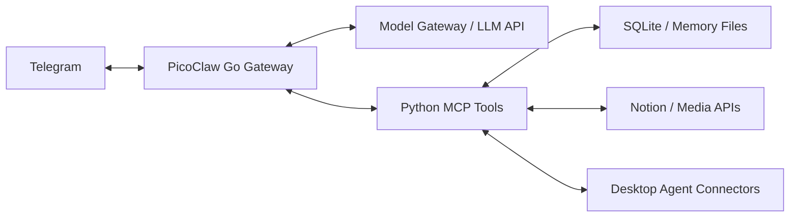

# Fatfish

[简体中文](README.md) | English

Fatfish is a self-hosted personal AI assistant built on [PicoClaw](https://github.com/sipeed/picoclaw). It uses Telegram as its primary interface and brings conversation, memory, task tracking, content reading, and coding-agent collaboration into one runtime.

The project addresses practical problems in long-running conversations: recovering actual dialogue, keeping memory traceable to its sources, reducing repetitive tool calls, and distinguishing a returned request from a completed task.

## Features

- **Telegram interaction:** Private and group conversations, text and media delivery, quoted replies, and status checks based on local receive and delivery records.
- **Conversation context and memory:** Combines session history, summaries of earlier conversations, and long-term memory. Supports history compaction and archival of source messages. `chat_recall` retrieves matching messages, surrounding context, and source IDs in one call.
- **Notion tasks:** Synchronizes checkboxes and nested tasks from a configured Notion page in the background, then adds a compact list of incomplete items to the owner's private-chat context. Sync timestamps and manual refresh are available.
- **Diary preparation:** `diary_prepare` gathers source conversations, reading records, the existing diary, and its revision for a chosen date. The model writes the entry, which is saved through the versioned memory interface.
- **Coding-agent collaboration:** Connects to Codex, DSH, and Claude Code sessions. `codex_overview` brings together connection state, progress snapshots, request receipts, and the latest cached quota information.
- **Content and media:** Provides reading integrations for X, Bilibili, and Douyin. Telegram emotes are sent as stickers, photos, or animations according to type; local emote selection, delivery, and accounting can run in one call.
- **On-demand tools:** MCP tools can be discovered by search before their definitions are loaded. The tool service can also batch independent reads.
- **Reminders and background maintenance:** Supports reminders, silent alarms, and diary maintenance; actual behavior depends on deployment configuration and runtime state.

External integrations depend on account permissions, APIs, and the content being accessed. For example, subtitles or transcripts are not available for every video, and coding-agent collaboration requires the relevant connector to be online.

## Architecture



The Go process handles messaging channels, model calls, context assembly, and tool orchestration. The Python tool service provides memory, task, content-reading, and collaboration interfaces. The model gateway and desktop connectors are configured as needed for each deployment.

## Repository layout

| Path | Contents |
|---|---|
| `picoclaw/` | PicoClaw source and Fatfish's Go extensions |
| `server-setup/` | Python tool service, model gateway, memory and collaboration modules, and tests |
| `codex-control/` | Desktop coding-agent connectors and tests |
| `x-reader/` | X content reader |
| `workspace-tools/` | Emote selection, delivery, and accounting scripts |
| `config/` | Configuration examples without live credentials |
| `templates/` | Generic agent, operations guide, and profile templates |
| `deploy/systemd/` | Linux service unit templates |
| `docs/` | Operations, source provenance, and release verification records |

## Build and test

The required Go version is specified in [`picoclaw/go.mod`](picoclaw/go.mod), currently **1.25.11**. The Python tools use Python 3; some media and external-platform integrations also require their own dependencies, credentials, or connectors.

Run the relevant Python checks from the repository root:

```sh
python3 server-setup/test-common-workflows.py
python3 server-setup/test-tool-efficiency.py
python3 workspace-tools/test_emotes.py
```

Build the Go gateway and run the Fatfish checks:

```sh
cd picoclaw
go test -tags goolm,stdjson ./pkg/agent -run TestFatfish -count=1
mkdir -p ../build
go build -tags goolm,stdjson -o ../build/picoclaw ./cmd/picoclaw
```

## Configuration and deployment

This repository was extracted from a working personal deployment; it is not a one-click hosted product. Start with the [operations guide](docs/OPERATIONS.md), then configure the model, Telegram, tool service, Notion, and connectors for your own environment. Files under `config/` and `deploy/systemd/` are starting points: paths, service accounts, and credential locations need to be adapted. The operations and release notes are primarily in Chinese.

The SOUL and USER files in the repository are generic templates. Actual personal profiles, chat history, memory databases, tokens, and other deployment-private data belong in the deployment environment. See the [release verification record](docs/RELEASE-2026-11-04.md) for the scope of completed checks; source code alone does not establish that every external integration has been verified in another environment.

## Attribution and license

Fatfish is based on [sipeed/picoclaw](https://github.com/sipeed/picoclaw). The upstream baseline and source provenance are recorded in [`docs/source-snapshot.json`](docs/source-snapshot.json). The repository is distributed under the [MIT License](LICENSE); third-party components retain their own licenses.
