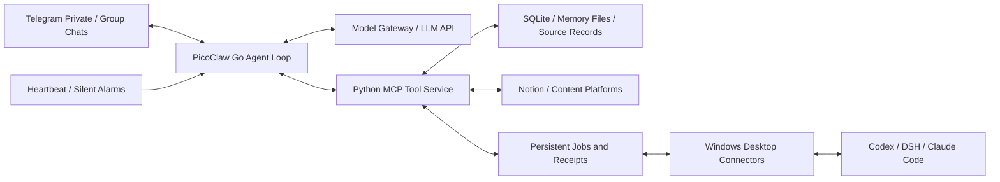

# Fatfish

[简体中文](README.md) | English

Fatfish is a self-hosted personal AI assistant and conversation companion built on [PicoClaw](https://github.com/sipeed/picoclaw). It uses Telegram as its primary interface and model APIs for understanding and tool selection, bringing long-running conversation, memory, proactive sharing, and coding-agent collaboration into one runtime.

The project focuses on three engineering problems: **preserving conversational continuity within a finite context, tracking real execution across machines, and staying responsive to people while background work runs.** Its implementation includes PicoClaw runtime extensions, a Python tool service, desktop connectors, and persistent workflows.

## Architecture



The Go process handles messaging, context assembly, model calls, and tool orchestration. The Python service provides memory, tasks, content reading, and collaboration interfaces. The server handles lightweight coordination and storage; desktop connectors reuse the computer's project environments and coding tools. Models run through APIs. Desktop-dependent tools require the relevant connector to be online.

## Key design decisions

### 1. Context and memory: retain sources, assemble input on demand

Long conversations accumulate dialogue, tool JSON, transcripts, and execution logs. Fatfish separates **stored source records** from **the context view sent to the model**:

- Fold large, already-consumed tool outputs into short previews, result states, and retrieval references such as `record_id / source_id / job_id`. Keep the current unread tool batch intact.
- When dialogue must be compacted, first produce a continuation summary covering responses, jokes, corrections, and unfinished topics; archive the source messages before retiring active history. If summarization fails, retain attributed excerpts.
- Separate persistent context by responsibility: SOUL describes expression and interaction, USER holds lasting preferences, AGENT holds general principles, and HEARTBEAT supports background scenarios. Retrieve specific experiences from chat, diaries, and reading records.
- Keep sources, timestamps, expiry, and replacement relationships with memories. Corrections make old records historical and provide updated facts alongside relevant summaries; background maintenance handles related free-text references.
- Maintain one canonical set of profile files. Writes require `expected_revision`, retain earlier versions, and verify the saved content by reading it back, reducing conflicting updates between the assistant and maintenance code.

This trades storage and retrieval work for conversational continuity. An archived source is not necessarily visible to the model in the current turn, and summaries can still lose detail.

Implementation: [context folding and archival](picoclaw/pkg/agent/fatfish_context_compact.go), [memory context and corrections](picoclaw/pkg/agent/fatfish_memory.go), [versioned file writes](server-setup/memory_notes.py), and [incremental memory maintenance](server-setup/memory_learning.py).

### 2. Cross-machine collaboration: distinguish requests, chats, and execution

The Telegram assistant and desktop coding tools communicate through persistent queues. SQLite stores requests, events, and receipts; Windows connectors claim requests over an SSH channel, execute them, and return results.

- `job_id` identifies a bridge request, `thread_id` a coding chat, and `turn_id` an actual execution turn. Request completion, queue acceptance, execution start, and task completion are tracked separately.
- Existing Codex desktop chats are automatically registered for native sharing. Messages enter the original owner's chat queue, preserving desktop execution ownership and avoiding competing writers. Connector-created independent tasks keep their own execution path.
- Native queue submissions use stable message identifiers and check for existing entries before enqueueing. Task completion is confirmed against actual turns and completion receipts. Query results and completion events share consumption records to reduce duplicate wakeups.
- DSH and Claude Code have separate adapters, with their own session, continuation, and receipt semantics.

Connectors add online dependencies and state management, while preserving real desktop project environments and chat context. Uncertain states remain inspectable rather than being reported as completed tasks.

Implementation: [server collaboration queue](server-setup/codex_bridge.py), [native Codex routing](codex-control/worker.py), [DSH connector](codex-control/dsh_connector.py), and [Claude Code connector](codex-control/claude_connector.py).

### 3. Scheduling and delivery: prioritize people, keep internal results quiet

Programmatic checks, model wakeups, and user-visible messages are separate operations. Timers provide opportunities to act, completion events provide reasons to continue, and the model decides what to do or share.

- Background events wait while a human turn is active. Background work can save a checkpoint and yield between model or tool batches when a human message arrives, then continue later. Already-dispatched mutations retain their actual receipts.
- Programs wait for slow queries and wake the model when results arrive, reducing repeated model-driven status checks.
- Automatic final text from heartbeats, silent alarms, and collaboration callbacks stays internal by default. Proactive sharing uses explicit sending tools; control markers and internal receipts stay separate from chat text.
- Delivery accounting uses actual message IDs and per-part receipts. `unknown` means delivery is unconfirmed and does not justify blind retries. Deduplication uses job, event, and message identities while preserving genuine new progress.

Yielding is cooperative at safe boundaries, and cross-platform delivery is not claimed to provide strict end-to-end exactly-once semantics. Explicit states keep completed actions traceable after failures.

Implementation: [background checkpoints](picoclaw/pkg/agent/background_yield.go), [collaboration event wakeups](picoclaw/pkg/agent/fatfish_codex.go), [internal output isolation](picoclaw/pkg/agent/output_isolation.go), and [tool runtime and delivery accounting](server-setup/runtime_policy.py).

## Efficiency and common workflows

- **On-demand loading:** Keep a compact AGENT core and read detailed procedures when needed. Discover MCP tools before loading their schemas, leaving more input space for conversation.
- **Two kinds of caching:** The model gateway places the changing clock at the end of requests to preserve stable prefixes. The tool layer reuses reads by arguments, conversation scope, and resource version, invalidates cached reads after mutations, and coalesces identical in-flight queries.
- **Ordered concurrency:** Run independent reads in parallel batches; execute sends and mutations in the supplied order. Put dependent operations in a later batch.
- **Combined workflows:** `chat_recall` combines search and expansion, `diary_prepare` gathers diary sources and revisions, and `codex_overview` aggregates collaboration state, reducing model round trips for routine sequences.
- **External-data snapshots:** A program synchronizes Notion tasks periodically; chat turns read a local snapshot. Failed syncs preserve the last complete result and successful timestamp, making freshness explicit without blocking each reply on an external request.

Implementation: [model gateway](server-setup/budget-gateway.py), [tool caching and batching](server-setup/tool_efficiency.py), [common workflows](server-setup/common_workflows.py), and [Notion task synchronization](server-setup/notion_todos.py).

## Features

- **Telegram interaction:** Private and group conversations, text and media delivery, quoted replies, and status checks based on local receive and delivery records.
- **Conversation context and memory:** Combines session history, summaries of earlier conversations, and long-term memory. Supports history compaction and archival of source messages. `chat_recall` retrieves matching messages, surrounding context, and source IDs in one call.
- **Notion tasks:** Synchronizes checkboxes and nested tasks from a configured Notion page in the background, then adds a compact list of incomplete items to the owner's private-chat context. Sync timestamps and manual refresh are available.
- **Diary preparation:** `diary_prepare` gathers source conversations, reading records, the existing diary, and its revision for a chosen date. The model writes the entry, which is saved through the versioned memory interface.
- **Coding-agent collaboration:** Connects to Codex, DSH, and Claude Code sessions. `codex_overview` brings together connection state, progress snapshots, request receipts, and the latest cached quota information.
- **Content and media:** Provides reading integrations for X, Bilibili, and Douyin. Telegram emotes are sent as stickers, photos, or animations according to type; local emote selection, delivery, and accounting can run in one call.
- **On-demand tools:** MCP tools can be discovered by search before their definitions are loaded. The tool service can also batch independent reads.
- **Reminders and background maintenance:** Supports reminders, silent alarms, and diary maintenance; actual behavior depends on deployment configuration and runtime state.

External integrations depend on account permissions, APIs, and the content being accessed. For example, subtitles or transcripts are not available for every video, and coding-agent collaboration requires the relevant connector to be online.

## Repository layout

| Path | Contents |
|---|---|
| `picoclaw/` | PicoClaw source and Fatfish's Go extensions |
| `server-setup/` | Python tool service, model gateway, memory and collaboration modules, and tests |
| `codex-control/` | Desktop coding-agent connectors and tests |
| `x-reader/` | X content reader |
| `workspace-tools/` | Emote selection, delivery, and accounting scripts |
| `config/` | Configuration examples without live credentials |
| `templates/` | Generic agent, operations guide, and profile templates |
| `deploy/systemd/` | Linux service unit templates |
| `docs/` | Operations, source provenance, and release verification records |

## Build and test

The required Go version is specified in [`picoclaw/go.mod`](picoclaw/go.mod), currently **1.25.11**. The Python tools use Python 3; some media and external-platform integrations also require their own dependencies, credentials, or connectors.

Run the relevant Python checks from the repository root:

```sh
python3 server-setup/test-common-workflows.py
python3 server-setup/test-tool-efficiency.py
python3 workspace-tools/test_emotes.py
```

Build the Go gateway and run the Fatfish checks:

```sh
cd picoclaw
go test -tags goolm,stdjson ./pkg/agent -run TestFatfish -count=1
mkdir -p ../build
go build -tags goolm,stdjson -o ../build/picoclaw ./cmd/picoclaw
```

## Configuration and deployment

This repository was extracted from a working personal deployment; it is not a one-click hosted product. Start with the [operations guide](docs/OPERATIONS.md), then configure the model, Telegram, tool service, Notion, and connectors for your own environment. Files under `config/` and `deploy/systemd/` are starting points: paths, service accounts, and credential locations need to be adapted. The operations and release notes are primarily in Chinese.

The SOUL and USER files in the repository are generic templates. Actual personal profiles, chat history, memory databases, tokens, and other deployment-private data belong in the deployment environment. See the [release verification record](docs/RELEASE-2026-11-04.md) for the scope of completed checks; source code alone does not establish that every external integration has been verified in another environment.

## Attribution and license

Fatfish is based on [sipeed/picoclaw](https://github.com/sipeed/picoclaw). The upstream baseline and source provenance are recorded in [`docs/source-snapshot.json`](docs/source-snapshot.json). The repository is distributed under the [MIT License](LICENSE); third-party components retain their own licenses.
