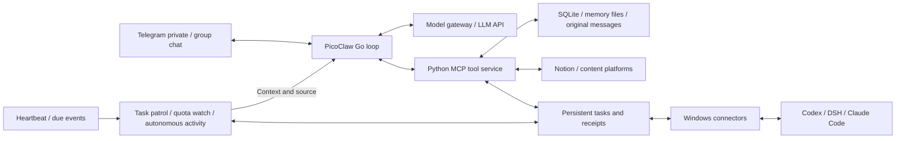

# Fatfish / 大肥鱼

[简体中文](README.md) | English

## What it is

Fatfish is a personal AI assistant and conversation companion built on [PicoClaw](https://github.com/sipeed/picoclaw), with Telegram as its main entry point. It connects long-running conversations, memory, proactive sharing, and desktop coding agents, while a self-hosted server keeps records and schedules activity.

## Problems it solves

- **Keeping a long conversation connected.** Original messages remain available, while each model call reads recent exchanges and summaries of earlier conversations. Details can be retrieved when needed, keeping context manageable and summary sources inspectable.
- **Following work across machines.** The server dispatches tasks to Codex, DSH, or Claude Code on the desktop and saves execution receipts and delivered files. Those records establish progress and completion, reducing repeated polling and duplicate dispatches.
- **Making room for initiative and cancellation.** Companion chats, free activity, task patrols, and quota watches have their own schedules. Programs provide opportunities, the model chooses an activity, and the user can adjust or cancel plans.
- **Responding to people during background work.** Human messages take priority, and background work saves progress and yields at suitable boundaries. Internal conclusions stay in records, with explicit sends used to contact the user.

## How it works

The Go loop receives messages, assembles context, calls the model, and schedules tools. Python services provide memory, tasks, content reading, and execution records, while Windows connectors let coding agents use existing desktop project environments.

## Where to find details

| What you need | Entry point |
|---|---|
| Design decisions, state rules, and feature details | [Design and implementation](docs/DESIGN.md) |
| Build, tests, configuration, and maintenance | [Operations](docs/OPERATIONS.md) |
| Deployed versions, verification, and rollback | [Deployed state](docs/DEPLOYED.md) |
| Upstream baseline and source provenance | [Source snapshot](docs/source-snapshot.json) |

Detailed guides are in Chinese. The project uses the [MIT License](LICENSE), and third-party components retain their own licenses.
