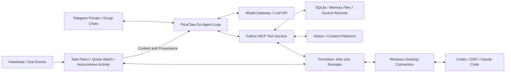
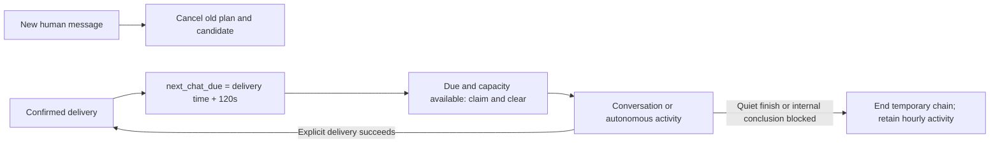

# Fatfish

[简体中文](README.md) | English

Fatfish is a self-hosted personal AI assistant and conversation companion built on [PicoClaw](https://github.com/sipeed/picoclaw). It uses Telegram as its primary interface and model APIs for understanding and tool selection, bringing long-running conversation, memory, proactive sharing, and coding-agent collaboration into one runtime.

The project focuses on three engineering problems: **preserving conversational continuity within a finite context, tracking real execution across machines, and staying responsive to people while background work runs.** Its implementation includes PicoClaw runtime extensions, a Python tool service, desktop connectors, and persistent workflows.

## Architecture



The Go process handles messaging, context assembly, model calls, and tool orchestration. The Python service provides memory, tasks, content reading, and collaboration interfaces. The server handles lightweight coordination and storage; desktop connectors reuse the computer's project environments and coding tools. Models run through APIs. Desktop-dependent tools require the relevant connector to be online.

## Key design decisions

### 1. Context and memory: retain sources, assemble input on demand

Long conversations accumulate dialogue, tool JSON, transcripts, and execution logs. Fatfish separates **stored source records** from **the context view sent to the model**:

- Fold large, already-consumed tool outputs into short previews, result states, and retrieval references such as `record_id / source_id / job_id`. Keep the current unread tool batch intact.
- Store attributed dialogue, confirmed deliveries, reasoning, and tool details under stable turn numbers, separately from the model's input view. Summary material omits execution logs and internal reasoning while retaining tool reads of actual conversations and diaries as labeled sources.
- Generate a candidate summary, then validate speakers, turn numbers, exact quotations, coverage, and protected agreements. Rendered prose plus separate agreements must fit within **1,800 characters**, without a target length. Activate the new version and advance coverage only after acceptance; rejection retains the previous version, source records, and reason. Stale inputs cannot overwrite newer state.
- Separate persistent context by responsibility: SOUL describes expression and interaction, USER holds lasting preferences, AGENT holds general principles, and HEARTBEAT supports background scenarios. Retrieve specific experiences from chat, diaries, and reading records.
- Keep sources, timestamps, expiry, and replacement relationships with memories. Corrections make old records historical and provide updated facts alongside relevant summaries; background maintenance handles related free-text references.
- Maintain one canonical set of profile files. Writes require `expected_revision`, retain earlier versions, and verify the saved content by reading it back, reducing conflicting updates between the assistant and maintenance code.

Three kinds of records serve distinct purposes:

| Record | Contents | How it reaches the model |
|---|---|---|
| Chat summary | Responses, shared jokes, feelings, clarified misunderstandings, and important agreements | A continuation view of earlier dialogue; exact quotations remain traceable to original turns |
| Diary | Richer dated experiences, reactions, reflections, and interaction details; **18,000 bytes** per entry across writes, reads, and search reads | Each turn lists only existing paths for today and the previous two days; `memory_find` retrieves matches and `memory_note_read` expands entries. Older diaries remain searchable |
| Task record | Goals, current agreements, progress, operations, executor IDs, receipts, and acceptance evidence | Injected into the corresponding task's execution context |

Technical topics in summaries and diaries retain the user's ideas, choices, and the course of the conversation; file lists, deployment steps, and test data belong in task records. MEMORY and profile files retain their separate size limits.

This trades storage and retrieval work for conversational continuity. An archived source is not necessarily visible to the model in the current turn, and summaries can still lose detail.

Implementation: [turn storage, material projection, and summary acceptance](picoclaw/pkg/contextledger/), [summary prompt](picoclaw/pkg/agent/fatfish_summary_prompt.txt), [context assembly](picoclaw/pkg/agent/context_fatfish.go), [tool-output folding](picoclaw/pkg/agent/fatfish_context_compact.go), [memory corrections](picoclaw/pkg/agent/fatfish_memory.go), [versioned file writes](server-setup/memory_notes.py), and [diary maintenance](server-setup/diary_maintenance.py).

### 2. Cross-machine collaboration: distinguish requests, chats, and execution

The Telegram assistant and desktop coding tools communicate through persistent queues. SQLite stores requests, events, and receipts; Windows connectors claim requests over an SSH channel, execute them, and return results.

- `job_id` identifies a bridge request, `thread_id` a coding chat, and `turn_id` an actual execution turn. Request completion, queue acceptance, execution start, and task completion are tracked separately.
- Existing Codex desktop chats are automatically registered for native sharing. Messages enter the original owner's chat queue, preserving desktop execution ownership and avoiding competing writers. Connector-created independent tasks keep their own execution path.
- Native queue submissions use stable message identifiers and check for existing entries before enqueueing. Task completion is confirmed against actual turns and completion receipts. Query results and completion events share consumption records to reduce duplicate wakeups.
- DSH and Claude Code have separate adapters, with their own session, continuation, and receipt semantics.
- A shared registration and dispatch entry associates `task_id` with complete `thread_id / job_id / turn_id` receipts. Deduplication compares the exact instruction and requirement version; different follow-ups enter the queue. A new goal owns its task and execution chain while reusing the native chat when appropriate.
- Request acceptance, execution, receipt processing, and artifact delivery have separate states. Receipt recovery reprocesses existing results without dispatching another executor turn. Default reads fetch lightweight metadata and queue state; `detail=history` expands content.
- `artifact` retrieves an existing executor file, then `python3 tools/task_artifact.py receive --job JOB_ID --to state/report.md` writes it atomically and records size, SHA-256, and readback verification. File bytes stay outside model context; the per-file limit is 128 KiB.

Connectors add online dependencies and state management, while preserving real desktop project environments and chat context. Uncertain states remain inspectable rather than being reported as completed tasks.

Implementation: [server collaboration queue](server-setup/codex_bridge.py), [execution state](server-setup/execution_status.py), [artifact receipts](server-setup/task_artifacts.py), [native Codex routing](codex-control/worker.py), [DSH connector](codex-control/dsh_connector.py), and [Claude Code connector](codex-control/claude_connector.py). See the [runtime recovery release record](docs/RELEASE-2026-11-06-RUNTIME-RECOVERY.md) for cancellation controls, storage repair, deployment evidence, and rollback.

### 3. Two wakeup classes: continuous tasks and revocable autonomous activity

The existing heartbeat lease and scheduling mechanisms serve three distinct persistent workflows:

| Workflow | Scheduling and context | Closing or cancelling |
|---|---|---|
| Task patrol | Every **25 minutes**, resume `agent:task-<task_id>` with the latest original goal, source, completion criteria, agreements, progress, and receipts | Record minor leftovers and `finish` when the practical goal is met. Cancelling patrol stops monitoring; stopping execution follows the task instruction |
| Quota watch | Use the executor's actual quota reset time; coalesce schedules for the same provider and window, then resume the original task | Independent of patrol; finishing one task does not disable the watcher |
| Autonomous activity | An adjustable default of about **15 minutes**, with relationship context, recent conversation, and a small continuation note | A quiet turn retains a future opportunity; after the user disables activity, only the user can re-enable it |

Task goals and effective agreements have sources and versions. Updates affect the corresponding task while earlier instructions remain in history. **Every model call reloads the current task record and canonical SOUL, core, and AGENT execution rules**, without automatically importing unrelated conversation summaries. An audit of the assembled request checks the task ID, version, and content, rather than merely checking stored files.

To supplement a task during ordinary chat, reply to a message bound to that task for direct association. A natural follow-up such as “add a rate-limit section to that report” requires the model to identify the task and call its update or continuation tool. The record preserves the original supplement, source message ID, and a new version. Ambiguous references across multiple tasks require clarification; a conversational acknowledgement alone does not confirm synchronization.

**Updating the task record and notifying the executor are separate steps.** The next task model call reads the new version; an in-flight request is not rewritten. If Codex or another executor is already working, append the supplement to its original chat queue and retain the submission receipt. New instructions and versions can enter the queue while completed work is reused from its receipts.

Autonomous activity and its derived alarms, cron jobs, queued wakeups, and callbacks carry a source epoch. Disabling it cancels pending schedules and stops new actions at the next model-call or individual tool boundary. Late receipts are preserved but cannot restart the disabled activity or send messages. Ordinary chat, independent reminders, and user-assigned tasks retain their own lifecycles. **Already-dispatched autonomous executor jobs keep running**; disabling activity does not send a stop command to Codex or other executors.

An optional deployment setting `autonomy_daily_window`, for example `{"start":"18:00","end":"22:00","utc_offset_minutes":480}`, limits new free-activity wakeups to a daily window. With a 3600-second interval, opportunities fall at 18:00, 19:00, 20:00, and 21:00 UTC+8, then resume the next day at 18:00. Delayed heartbeat claims skip elapsed slots without a catch-up burst. An already-started turn may finish; task patrol and quota watches remain independent. Opening the daily window never re-enables an owner-disabled switch. Status includes the window, whether it is currently open, and the next due time.

Optional `companion_cadence_enabled=true` adds two-minute conversation opportunities through the same autonomous route, sharing persona, tools, and relationship context. A single nullable `next_chat_due` holds the plan: a new human message cancels the old plan and invalidates its generated candidate; a confirmed text, sticker, or image delivery sets the deadline to **120 seconds** after delivery. Claiming the deadline clears it first. A normally completed turn without a send ends this temporary chain; successful delivery schedules another opportunity. The assistant can converse, share, read, explore, organize, or pursue other authorized interests. The chain shares the daily window and master switch with autonomous activity; ending it quietly preserves the default free-activity schedule.

Heartbeat performs a lightweight due check every **5 seconds**, without calling the model when nothing is due. Active human turns and background leases retain the existing scheduler's priority. Before sending, a narrow filter checks background text, message parts, and media captions for known Chinese internal conclusions such as “本轮保持静默” (“this round stays silent”). A match keeps the whole batch internal and ends that turn, without asking the model to rewrite and resend it. Ordinary foreground farewells, quotations, and code discussions remain available; fixed rules do not claim to detect every paraphrase. The emote script uses the same delivery gate and real receipts, preserving selection and usage accounting; unconfirmed sends do not schedule another opportunity.

Task reporting has independent global and per-task switches, enabled by default. Explicit reports may describe blockers, decisions, or completion; disabling reports still allows progress and internal records. Contacting the user and retaining the next wakeup are separate decisions.

Every model call includes a program-generated current-event marker distinguishing human messages, autonomous wakeups, patrols, quota checks, and executor/tool receipts, with the source message ID. Tool continuations retain the true initiating source. The dynamic clock supplies time context, while original dialogue stays unchanged. See the [event-source release record](docs/RELEASE-2026-11-05-TURN-SOURCE.md) for real-input replays and rollback.

Implementation: [task versions, provenance, and wakeup state](server-setup/agent_loops.py), [per-call context assembly and audit](picoclaw/pkg/agent/fatfish_loops.go), [current-event provenance](picoclaw/pkg/agent/fatfish_turn_event.go), [cron provenance and cancellation](picoclaw/pkg/tools/fatfish_loop_cron.go), and [runtime tools and receipt routing](server-setup/runtime_policy.py).

Companion implementation: [shared deadline and delivery state](server-setup/companion_cadence.py), [internal-conclusion filter](server-setup/internal_note_filter.py), [lightweight heartbeat checks](picoclaw/pkg/heartbeat/service.go), and [emote delivery gate and accounting](workspace-tools/emote_send.py).

The program handles timing, source validation, delivery guards, and receipts. The model chooses its activity, whether to speak, and what to say:



`autonomy status` exposes `companion.next_chat_due`. A null value means no temporary conversation plan; it does not mean the autonomy master switch is off. Activity records distinguish `chat_armed`, `chat_claimed`, `chat_finished`, and cancellation reasons. See the [companion release record](docs/RELEASE-2026-11-06-COMPANION-CADENCE.md) for configuration, verification scope, and rollback.

### 4. Scheduling and delivery: prioritize people, keep internal results quiet

Programmatic checks, model wakeups, and user-visible messages are separate operations. Timers provide opportunities to act, completion events provide reasons to continue, and the model decides what to do or share.

Events select separate context routes before sharing the model and tool executor:

| Route | Session and continuation material |
|---|---|
| Ordinary chat | The routed chat session with normal conversation history, persona, and relevant memory |
| Task patrol and task receipts | Stable `agent:task-<task_id>` history, with the latest goal, agreements, control state, and actual receipts reloaded for each call |
| Autonomous activity | `agent:autonomy-<epoch>`, assembled from relationship context, recent exchanges, relevant memory, and a small continuation note |

When a human message arrives, background work saves completed tool results and yields its execution slot at a safe boundary. A later patrol or receipt resumes the original task from its records; continuation is not guaranteed immediately after chat ends. Already-dispatched external work can keep running. The separation covers history, goals, provenance, and delivery paths; tools and the workspace remain shared.

- Background events wait while a human turn is active. Background work can save a checkpoint and yield between model or tool batches when a human message arrives, then continue later. Already-dispatched mutations retain their actual receipts.
- Programs wait for slow queries and wake the model when results arrive, reducing repeated model-driven status checks.
- Automatic final text from tasks, autonomous activity, heartbeats, and collaboration callbacks stays internal. Contacting the user requires an explicit sending tool; an internal conclusion such as “did not disturb the user” is not automatically posted. Independent reminders retain their normal delivery behavior.
- Delivery accounting uses actual message IDs and per-part receipts. `unknown` means delivery is unconfirmed and does not justify blind retries. Deduplication uses job, event, and message identities while preserving genuine new progress.

Yielding is cooperative at safe boundaries, and cross-platform delivery is not claimed to provide strict end-to-end exactly-once semantics. Explicit states keep completed actions traceable after failures.

Implementation: [background checkpoints](picoclaw/pkg/agent/background_yield.go), [collaboration event wakeups](picoclaw/pkg/agent/fatfish_codex.go), [internal output isolation](picoclaw/pkg/agent/output_isolation.go), and [tool runtime and delivery accounting](server-setup/runtime_policy.py).

## Efficiency and common workflows

- **On-demand loading:** Keep a compact AGENT core and read detailed procedures when needed. Discover MCP tools before loading their schemas, leaving more input space for conversation.
- **Two kinds of caching:** The model gateway places the changing clock at the end of requests to preserve stable prefixes. The tool layer reuses reads by arguments, conversation scope, and resource version, invalidates cached reads after mutations, and coalesces identical in-flight queries.
- **Ordered concurrency:** Run independent reads in parallel batches; execute sends and mutations in the supplied order. Put dependent operations in a later batch.
- **Combined workflows:** `chat_recall` combines search and expansion, `diary_prepare` gathers diary sources and revisions, and `codex_overview` aggregates collaboration state, reducing model round trips for routine sequences.
- **External-data snapshots:** A program synchronizes Notion tasks periodically; chat turns read a local snapshot. Failed syncs preserve the last complete result and successful timestamp, making freshness explicit without blocking each reply on an external request.

Implementation: [model gateway](server-setup/budget-gateway.py), [tool caching and batching](server-setup/tool_efficiency.py), [common workflows](server-setup/common_workflows.py), and [Notion task synchronization](server-setup/notion_todos.py).

## Features

- **Telegram interaction:** Private and group conversations, text and media delivery, quoted replies, and status checks based on local receive and delivery records.
- **Conversation context and memory:** Combines session history, summaries of earlier conversations, and long-term memory. Supports history compaction and archival of source messages. `chat_recall` retrieves matching messages, surrounding context, and source IDs in one call.
- **Notion tasks:** Synchronizes checkboxes and nested tasks from a configured Notion page in the background. `my_todos` reads the complete list on demand; sync timestamps and manual refresh are available.
- **Diary preparation:** `diary_prepare` gathers source conversations, reading records, the existing diary, and its revision for a chosen date. The model writes the entry, which is saved through the versioned memory interface.
- **Coding-agent collaboration:** Connects to Codex, DSH, and Claude Code sessions. `codex_overview` brings together connection state, progress snapshots, request receipts, and the latest cached quota information.
- **Content and media:** Provides reading integrations for X, Bilibili, and Douyin. Telegram emotes are sent as stickers, photos, or animations according to type; local emote selection, delivery, and accounting can run in one call.
- **On-demand tools:** MCP tools can be discovered by search before their definitions are loaded. The tool service can also batch independent reads.
- **Reminders and background maintenance:** Supports reminders, silent alarms, and diary maintenance; actual behavior depends on deployment configuration and runtime state.
- **Tasks and autonomous activity:** `task_loop` registers, dispatches, updates, reports, and closes tasks; `quota_wait` watches actual reset times; `autonomy` inspects activity, adjusts intervals, and manages its switch.

External integrations depend on account permissions, APIs, and the content being accessed. For example, subtitles or transcripts are not available for every video, and coding-agent collaboration requires the relevant connector to be online.

## Repository layout

| Path | Contents |
|---|---|
| `picoclaw/` | PicoClaw source and Fatfish's Go extensions |
| `server-setup/` | Python tool service, model gateway, memory and collaboration modules, and tests |
| `codex-control/` | Desktop coding-agent connectors and tests |
| `x-reader/` | X content reader |
| `workspace-tools/` | Emote selection, delivery, and accounting scripts |
| `config/` | Configuration examples without live credentials |
| `templates/` | Generic agent, operations guide, and profile templates |
| `deploy/systemd/` | Linux service unit templates |
| `docs/` | Operations, source provenance, and release verification records |

## Build and test

The required Go version is specified in [`picoclaw/go.mod`](picoclaw/go.mod), currently **1.25.11**. The Python tools use Python 3; some media and external-platform integrations also require their own dependencies, credentials, or connectors.

Run the relevant Python checks from the repository root:

```sh
python3 server-setup/test-common-workflows.py
python3 server-setup/test-tool-efficiency.py
python3 server-setup/test-agent-loops.py
python3 server-setup/test-pulse-policy.py
python3 server-setup/test-autonomy-window.py
python3 server-setup/test-companion-cadence.py
python3 server-setup/test-internal-note-filter.py
python3 workspace-tools/test_emotes.py
python3 -m unittest discover -s workspace-tools -p 'test_emote_runtime_receipts.py'
```

Build the Go gateway and run the Fatfish checks:

```sh
cd picoclaw
go test -tags goolm,stdjson ./pkg/agent -run TestFatfish -count=1
go test -tags goolm,stdjson ./pkg/contextledger -count=1
go test -tags goolm,stdjson ./pkg/tools -run 'Test.*(Fatfish|Cron)' -count=1
go test -tags goolm,stdjson ./pkg/heartbeat -run 'TestDueChecker' -count=1
mkdir -p ../build
go build -tags goolm,stdjson -o ../build/picoclaw ./cmd/picoclaw
```

## Configuration and deployment

This repository was extracted from a working personal deployment; it is not a one-click hosted product. Start with the [operations guide](docs/OPERATIONS.md), then configure the model, Telegram, tool service, Notion, and connectors for your own environment. Files under `config/` and `deploy/systemd/` are starting points: paths, service accounts, and credential locations need to be adapted. The operations and release notes are primarily in Chinese.

The SOUL and USER files in the repository are generic templates. Actual personal profiles, chat history, memory databases, tokens, and other deployment-private data belong in the deployment environment. Deploy only the required modules and use revision-based profile writes; rollback checks versions and retains data created after deployment. See the [diary and wakeup release record](docs/RELEASE-2026-11-05-DIARY-AGENT-LOOPS.md) for evidence and rollback steps, and the [summary source-validation record](docs/RELEASE-2026-11-05-SUMMARY-SOURCES.md) for summary acceptance and history retention. Source code alone does not establish that every external integration has been verified in another environment.

## Attribution and license

Fatfish is based on [sipeed/picoclaw](https://github.com/sipeed/picoclaw). The upstream baseline and source provenance are recorded in [`docs/source-snapshot.json`](docs/source-snapshot.json). The repository is distributed under the [MIT License](LICENSE); third-party components retain their own licenses.
