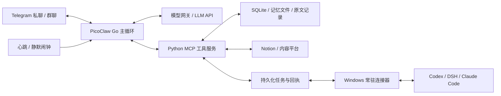

# Fatfish / 大肥鱼

简体中文 | [English](README.en.md)

Fatfish 是基于 [PicoClaw](https://github.com/sipeed/picoclaw) 扩展的个人 AI 助手和聊天伙伴。它以 Telegram 为主要交互入口，通过模型 API 理解对话、选择工具，把长期交流、记忆、主动分享和编码 Agent 协作连接到一套可自行部署的运行环境中。

项目围绕长期运行中的三个问题展开：**有限上下文里怎样接续真实交流，跨机器执行怎样确认任务进展，后台办事时怎样及时回应真人。** 工程工作包括 PicoClaw 运行时的源码扩展，以及 Python 工具服务、桌面连接器和持久化工作流的实现。

## 架构



Go 主程序负责消息通道、上下文组装、模型调用和工具调度；Python 工具服务提供记忆、待办、内容读取及协作接口。服务器承载轻量控制与记录，桌面连接器复用电脑上的项目环境和编码工具，模型通过 API 运行。依赖桌面的工具需要对应连接器在线。

## 关键设计

### 1. 上下文与记忆：保留原文，按需组织输入

长期聊天同时积累对话、工具 JSON、字幕和执行日志。Fatfish 将**原始记录**与**本轮送入模型的上下文视图**分开管理：

- 优先折叠已经消费过的大工具输出，保留简短预览、结果状态和 `record_id / source_id / job_id` 等展开入口；当前尚未消费的工具批次保持完整。
- 确需压缩对话时，先生成接续摘要，保留双方回应、玩笑、纠正和待续话题，再归档原文、缩减活动历史。摘要失败时保留有说话人标注的原话摘录。
- 常驻背景按职责分层：SOUL 管表达与相处方式，USER 管持续偏好，AGENT 管通用原则，HEARTBEAT 用于后台场景；具体经历从聊天、日记和阅读记录中召回。
- 记忆保留来源、时间、有效期和替换关系。纠正使旧记录转为历史，并向相关摘要提供当前说法；自由文本中的关联表述仍由后台整理。
- 人格文件只有一套正本。写入带 `expected_revision`，旧版本留档，保存后读回核对，减少助手与维护程序相互覆盖。

这套设计用存储与按需检索换取交流连续性。原文可查不代表模型每轮都已读到，摘要也仍可能损失细节。

实现入口：[上下文折叠与归档](picoclaw/pkg/agent/fatfish_context_compact.go)、[记忆上下文与纠正](picoclaw/pkg/agent/fatfish_memory.go)、[版本化文件写入](server-setup/memory_notes.py)、[增量记忆整理](server-setup/memory_learning.py)。

### 2. 跨机器协作：区分请求、会话和实际执行

Telegram 助手与桌面编码工具通过持久化队列协作。SQLite 保存请求、事件和回执，Windows 连接器通过 SSH 通道领取请求、执行并回传结果。

- `job_id` 标识桥接请求，`thread_id` 标识编码对话，`turn_id` 标识实际执行回合。请求返回、进入队列、开始执行和执行完成分别记录。
- 已有 Codex 桌面对话自动登记为原生共用，向原执行端的会话队列投递，保持桌面端的会话执行权，避免两个执行端争用 writer。连接器新建的独立任务保留自己的路径。
- 原生队列提交沿用稳定的消息标识，提交前查询已有项；完成状态结合实际回合与完成回执确认。查询结果与完成事件共用消费登记，减少同一结果重复唤醒。
- DSH 和 Claude Code 使用各自适配器；各框架的会话、续接和回执语义分别处理。

连接器增加了在线依赖与状态管理成本，同时保留桌面的真实项目环境和会话上下文。状态不确定时保留待核对记录，避免把“已提交”报告成“已完成”。

实现入口：[服务器协作队列](server-setup/codex_bridge.py)、[Codex 原生会话路由](codex-control/worker.py)、[DSH 连接器](codex-control/dsh_connector.py)、[Claude Code 连接器](codex-control/claude_connector.py)。

### 3. 前后台调度与投递：真人优先，内部结果保持静默

程序检查、模型唤醒和给用户发消息是三个独立动作。时钟提供行动机会，任务完成事件提供接续依据，模型决定具体内容。

- 已有真人回合时，后台事件等待；后台运行时收到真人消息，在模型或工具批次之间保存检查点、让位，随后接续。已经发出的修改动作保留真实回执。
- 慢查询由程序等待，结果返回后再唤醒模型，减少反复查状态的模型调用。
- 心跳、静默闹钟和协作回调的自动最终文本默认只存内部；主动分享通过发送工具投递，控制标记和内部回执与聊天正文分开。
- 发送依据实际消息 ID 与分段回执记账。`unknown` 表示投递尚未确认，不能据此盲目重发；去重依据任务、事件和消息身份，保留真实的新进展。

让位发生在安全边界，并非任意时刻立即抢占；跨平台投递也不宣称端到端严格 exactly-once。明确这些状态，使故障后仍能追踪已经做了什么。

实现入口：[后台检查点](picoclaw/pkg/agent/background_yield.go)、[协作事件唤醒](picoclaw/pkg/agent/fatfish_codex.go)、[内部输出隔离](picoclaw/pkg/agent/output_isolation.go)、[工具运行与投递记账](server-setup/runtime_policy.py)。

## 效率与常用流程

- **按需加载**：AGENT 保留短核心，具体操作流程按需读取；MCP 工具先搜索发现，再加载 schema，为实际对话留出输入空间。
- **两类缓存**：模型网关将动态时钟放在请求末尾，保持前缀稳定；工具层按参数、会话与资源版本复用读取，写入后失效，并合并相同的在途查询。
- **有序并发**：相互独立的读取分批并行，发送和修改按给定顺序执行；有前后依赖的操作放到下一批。
- **合并固定流程**：`chat_recall` 合并搜索与展开，`diary_prepare` 汇集日记材料与 revision，`codex_overview` 汇总协作状态，减少模型来回拼接固定步骤。
- **外部数据快照**：Notion 待办由程序定时同步，聊天直接读取本地快照；失败保留上次完整结果与成功时间，明确新鲜度，避免外部请求拖慢每轮回复。

实现入口：[模型网关](server-setup/budget-gateway.py)、[工具缓存与批处理](server-setup/tool_efficiency.py)、[常用工作流](server-setup/common_workflows.py)、[Notion 待办同步](server-setup/notion_todos.py)。

## 实现的功能

- **Telegram 交互**：支持私聊与群聊、文本和媒体发送、引用回复，以及基于本地接收和发送回执的状态查询。
- **对话上下文与记忆**：组合会话历史、较早对话摘要和长期记忆；支持历史压缩及原文归档。`chat_recall` 可以一次检索聊天原文、相关上下文和来源编号。
- **Notion 待办**：后台同步指定页面中的复选框和嵌套子任务，按需用 `my_todos` 一次读取完整清单；支持查看同步时间和按需刷新。
- **日记材料准备**：`diary_prepare` 按日期汇集聊天原文、阅读记录、已有日记和版本号，由模型整理表达，再通过版本化接口保存。
- **编码 Agent 协作**：通过连接器与 Codex、DSH 和 Claude Code 会话协作；`codex_overview` 汇总连接状态、进展快照、请求回执和最近额度。
- **内容与媒体**：提供 X、B 站和抖音的读取入口；Telegram 表情按类型发送为贴纸、图片或动画，本地表情库支持一次挑选、发送和记账。
- **工具按需发现**：MCP 工具可先通过搜索发现，再加载对应的工具定义；服务端也支持合并相互独立的读取操作。
- **提醒与后台维护**：支持提醒、静默闹钟和日记维护等能力，具体行为由部署配置及运行状态决定。

外部平台的可用功能取决于账号授权、接口和内容本身。例如，视频字幕或转写并非对所有链接都可用；编码 Agent 协作也需要相应连接器在线。

## 项目结构

| 路径 | 内容 |
|---|---|
| `picoclaw/` | PicoClaw 源码及 Fatfish 的 Go 扩展 |
| `server-setup/` | Python 工具服务、模型网关、记忆和协作模块及测试 |
| `codex-control/` | 桌面编码 Agent 连接器及测试 |
| `x-reader/` | X 内容读取组件 |
| `workspace-tools/` | 表情挑选、发送和记账脚本 |
| `config/` | 不含实际凭据的配置样例 |
| `templates/` | 通用 Agent、操作指南和个人资料模板 |
| `deploy/systemd/` | Linux 服务单元模板 |
| `docs/` | 维护说明、源码来源和发布验收记录 |

## 构建与测试

Go 版本以 [`picoclaw/go.mod`](picoclaw/go.mod) 为准，目前为 **1.25.11**。Python 工具使用 Python 3；部分媒体和外部平台功能还需要各自的依赖、凭据或连接器。

在仓库根目录运行相关 Python 检查：

```sh
python3 server-setup/test-common-workflows.py
python3 server-setup/test-tool-efficiency.py
python3 workspace-tools/test_emotes.py
```

构建 Go 主程序并运行 Fatfish 相关检查：

```sh
cd picoclaw
go test -tags goolm,stdjson ./pkg/agent -run TestFatfish -count=1
mkdir -p ../build
go build -tags goolm,stdjson -o ../build/picoclaw ./cmd/picoclaw
```

## 配置与部署

这是从实际个人部署整理出的源码项目，并非一键安装的托管产品。部署前请阅读[维护说明](docs/OPERATIONS.md)，按自己的环境配置模型、Telegram、工具服务、Notion 和所需连接器；`config/` 与 `deploy/systemd/` 中的文件是起点，需要调整路径、服务账号和凭据位置。

仓库中的 SOUL、USER 文件是通用模板。实际个人资料、聊天记录、记忆数据库、令牌及其他部署私有数据应由部署环境单独保存。具体验收范围见[最新发布记录](docs/RELEASE-2026-11-04-SHARED-PERMISSIONS.md)，不能由源码存在推断所有外部服务均已在其他环境中验证。

## 致谢与许可

本项目基于 [sipeed/picoclaw](https://github.com/sipeed/picoclaw)，上游基线及源码来源见 [`docs/source-snapshot.json`](docs/source-snapshot.json)。仓库使用 [MIT 许可](LICENSE)；第三方组件的许可随各组件保留。
