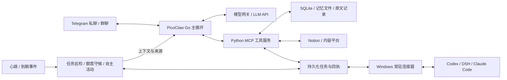

# Fatfish / 大肥鱼

简体中文 | [English](README.en.md)

Fatfish 是基于 [PicoClaw](https://github.com/sipeed/picoclaw) 扩展的个人 AI 助手和聊天伙伴。它以 Telegram 为主要交互入口，通过模型 API 理解对话、选择工具，把长期交流、记忆、主动分享和编码 Agent 协作连接到一套可自行部署的运行环境中。

项目围绕长期运行中的三个问题展开：**有限上下文里怎样接续真实交流，跨机器执行怎样确认任务进展，后台办事时怎样及时回应真人。** 工程工作包括 PicoClaw 运行时的源码扩展，以及 Python 工具服务、桌面连接器和持久化工作流的实现。

## 架构



Go 主程序负责消息通道、上下文组装、模型调用和工具调度；Python 工具服务提供记忆、待办、内容读取及协作接口。服务器承载轻量控制与记录，桌面连接器复用电脑上的项目环境和编码工具，模型通过 API 运行。依赖桌面的工具需要对应连接器在线。

## 关键设计

### 1. 上下文与记忆：保留原文，按需组织输入

长期聊天同时积累对话、工具 JSON、字幕和执行日志。Fatfish 将**原始记录**与**本轮送入模型的上下文视图**分开管理：

- 优先折叠已经消费过的大工具输出，保留简短预览、结果状态和 `record_id / source_id / job_id` 等展开入口；当前尚未消费的工具批次保持完整。
- 对话按固定轮号保存说话人、原话、实际发送回执、思考和工具详情；模型使用单独的投影视图。摘要材料移除执行日志与内部推断，保留工具读回的真实聊天、日记等来源内容。
- 摘要先生成候选，程序校验说话人、原轮号、逐字引文、覆盖范围和重要约定；渲染正文与独立约定合计最多 **1800 字符**，不要求凑满。验收通过后才激活新版本、推进覆盖点；失败保留旧版、原文和拒绝原因，过期材料不能覆盖更新后的状态。
- 常驻背景按职责分层：SOUL 管表达与相处方式，USER 管持续偏好，AGENT 管通用原则，HEARTBEAT 用于后台场景；具体经历从聊天、日记和阅读记录中召回。
- 记忆保留来源、时间、有效期和替换关系。纠正使旧记录转为历史，并向相关摘要提供当前说法；自由文本中的关联表述仍由后台整理。
- 人格文件只有一套正本。写入带 `expected_revision`，旧版本留档，保存后读回核对，减少助手与维护程序相互覆盖。

三种记录分别承接不同的内容：

| 记录 | 保存什么 | 怎样进入上下文 |
|---|---|---|
| 聊天摘要 | 双方怎样回应、相处、接梗、表达感受、纠正误会，以及重要约定 | 较早对话的接续视图；精确引文可回查原轮 |
| 日记 | 按日期保存更丰富的经历、反应、感想和相处细节；单篇上限 **18000 字节**，读写和搜索读取一致 | 每轮只列今天、昨天、前天已存在的路径；`memory_find` 检索，`memory_note_read` 展开，更早日记仍可找 |
| 任务记录 | 目标、当前约定、进度、操作、执行端 ID、回执和验收证据 | 只注入对应任务的执行上下文 |

技术话题在摘要和日记中保留用户的想法、选择及交流经过；文件清单、部署过程和测试数据由任务记录承接。MEMORY 和人格文件的现有容量约束保持独立，日记扩容不会同步放宽它们。

这套设计用存储与按需检索换取交流连续性。原文可查不代表模型每轮都已读到，摘要也仍可能损失细节。

实现入口：[原轮存储、材料投影与摘要验收](picoclaw/pkg/contextledger/)、[摘要提示词](picoclaw/pkg/agent/fatfish_summary_prompt.txt)、[上下文组装](picoclaw/pkg/agent/context_fatfish.go)、[工具输出折叠](picoclaw/pkg/agent/fatfish_context_compact.go)、[记忆上下文与纠正](picoclaw/pkg/agent/fatfish_memory.go)、[版本化文件写入](server-setup/memory_notes.py)、[日记维护](server-setup/diary_maintenance.py)。

### 2. 跨机器协作：区分请求、会话和实际执行

Telegram 助手与桌面编码工具通过持久化队列协作。SQLite 保存请求、事件和回执，Windows 连接器通过 SSH 通道领取请求、执行并回传结果。

- `job_id` 标识桥接请求，`thread_id` 标识编码对话，`turn_id` 标识实际执行回合。请求返回、进入队列、开始执行和执行完成分别记录。
- 已有 Codex 桌面对话自动登记为原生共用，向原执行端的会话队列投递，保持桌面端的会话执行权，避免两个执行端争用 writer。连接器新建的独立任务保留自己的路径。
- 原生队列提交沿用稳定的消息标识，提交前查询已有项；完成状态结合实际回合与完成回执确认。查询结果与完成事件共用消费登记，减少同一结果重复唤醒。
- DSH 和 Claude Code 使用各自适配器；各框架的会话、续接和回执语义分别处理。
- 登记目标与派单通过统一入口关联 `task_id`，绑定完整 `thread_id / job_id / turn_id`。任务发起、慢查询和完成回调接续稳定的任务会话。复用请求时核对**具体指令与指令版本**；补写、同步等新要求独立入队。新目标有自己的任务与执行链，可以复用同一个原生聊天。
- 请求接收、实际执行、回执处理和成果交付分别记账。真实终态优先于历史排队字段；回执处理失败保留执行成果，只重试接收处理，恢复回合不能再次派单。
- `read` 默认读取轻量状态与原生队列，`detail=history` 按需展开正文。连接器先处理前台请求，再轮询后台观察，降低慢查询叠加。
- 文件交付由 `artifact` 直接收取执行端原件，再运行 `python3 tools/task_artifact.py receive --job JOB_ID --to state/report.md`。程序原子写入当前工作区，校验大小、SHA-256 和读回结果，并保存任务交付回执；报告包含完整文件，不依赖完成文本搬运正文。单件上限 128 KiB。

连接器增加了在线依赖与状态管理成本，同时保留桌面的真实项目环境和会话上下文。状态不确定时保留待核对记录，避免把“已提交”报告成“已完成”。

实现入口：[服务器协作队列](server-setup/codex_bridge.py)、[执行状态归一](server-setup/execution_status.py)、[文件收取与交付回执](server-setup/task_artifacts.py)、[工作区落盘工具](workspace-tools/task_artifact.py)、[Codex 原生会话路由](codex-control/worker.py)、[DSH 连接器](codex-control/dsh_connector.py)、[Claude Code 连接器](codex-control/claude_connector.py)。

### 3. 两类唤醒：任务连续推进，自主活动可真正撤销

沿用 heartbeat 租约和现有定时机制，用持久化状态区分任务盯守、额度守候和自主活动：

| 机制 | 排程与上下文 | 收口或撤销 |
|---|---|---|
| 任务巡检 | 每 **25 分钟**，进入 `agent:task-<task_id>`，读取最新目标原话、来源、完成标准、约定、进展和执行回执 | 达到实际目的后记录小遗留并 `finish`；关闭巡检只停盯守，是否停止执行按任务指令处理 |
| 额度守候 | 根据执行端真实额度重置时间设置；同一提供方、同一窗口复用排程，到点接续原任务 | 独立于任务巡检，任务收口不顺带关闭监听 |
| 自主活动 | 默认约 **15 分钟**、可自行调整；正常相处背景、近期交流和少量活动续记 | 安静一轮仍有下次机会；用户关闭后，恢复由用户决定 |

任务目标及有效约定有来源和版本，补充要求只更新对应任务，旧说法留作历史。**每一次模型调用都重新读取最新任务记录和同源的 SOUL、core、AGENT 执行规范**，不自动带入普通陪聊摘要。模型调用前审计实际组装请求中的任务 ID、版本和内容，验证目标确实进入请求，而非仅保存到文件。

在普通聊天中补充任务时，回复一条与任务绑定的消息，程序可以直接关联；自然说“刚才那份报告再加……”时，需要模型识别对应任务，并调用任务更新或原会话续接工具。任务记录保存补充原话、来源消息号和新版本，其他任务保持各自的要求。多任务指代不清时先确认关联，聊天里答“收到”本身不是同步回执。

**更新任务记录和通知执行端是两步。** 新要求写入后，任务循环下一次模型调用读取新版；已经发出的请求不会被中途改写。若 Codex 等执行端正在运行，还需将补充指令追加到原会话队列并保存真实提交回执。新补充按新指令及版本入队，已完成工作按回执复用。例如：“那份报告加一节限流分析，已完成的调研不用重做。”

自主活动及派生闹钟、cron、队列和回调带来源 epoch。关闭时撤销待执行安排，并在下一次模型调用或逐个工具执行的安全边界停止派发新动作；迟到回执仍保存，但不能重新唤醒已关闭的活动或外发。普通聊天、独立提醒和用户交办的任务分别保留。**已交给执行端运行的自主任务继续运行**，关闭自主活动不会向 Codex 等执行端发停止指令。

“任务结束／剩下的我来／把任务时钟撤了”等明确指令先持久化到控制状态，再进入聊天；派生排程和迟到回调按最新控制版本复核。自主活动的 `delay_seconds / due_at` 只安排下一次机会，`interval_seconds` 调整循环间隔，`disable` 才是总开关。较早真人回合不能覆盖较新的关闭指令。同一任务、同一等待原因的维护检查合并，额度重置仍独立。

任务汇报有独立总开关及单任务开关，默认开启。开启时可显式报告阻断、决策需求和完成结果；关闭后仍可推进、保存内部记录。是否联系用户与是否保留下次唤醒分别决定。

每次模型调用都有程序生成的当前事件标识，区分真人消息、自主唤醒、任务巡检、额度检查及执行端/工具回执，带来源消息号；同轮工具续接保留真实触发来源。动态时钟仅作时间附注，原始聊天正文保持不变。实际回放与回滚见[来源标识修复记录](docs/RELEASE-2026-11-05-TURN-SOURCE.md)。

实现入口：[任务、来源版本与两类唤醒状态机](server-setup/agent_loops.py)、[逐次模型请求组装与审计](picoclaw/pkg/agent/fatfish_loops.go)、[当前事件来源](picoclaw/pkg/agent/fatfish_turn_event.go)、[cron 来源与撤销](picoclaw/pkg/tools/fatfish_loop_cron.go)、[运行时工具与回执接入](server-setup/runtime_policy.py)。

### 4. 前后台调度与投递：真人优先，内部结果保持静默

程序检查、模型唤醒和给用户发消息是三个独立动作。时钟提供行动机会，任务完成事件提供接续依据，模型决定具体内容。

普通聊天、任务和自主活动按事件分流，各自组装上下文，再共用模型与工具执行器：

| 路线 | 会话与接续材料 |
|---|---|
| 普通聊天 | 路由分配的聊天会话，读取正常聊天历史、人格与相关记忆 |
| 任务巡检及任务回执 | 固定 `agent:task-<task_id>`，保留任务历史，每次读取最新目标、约定、控制状态和真实回执 |
| 自主活动 | `agent:autonomy-<epoch>`，按正常相处背景、近期往来、相关记忆及少量续记组装这一轮 |

切换时保存已完成工具的结果，在安全边界结束后台本轮、释放执行槽，让真人消息先处理。之后由下一次巡检或回执读取原任务进展接续，不保证聊天结束后立即恢复；外部执行端已接收的工作可继续运行。隔离范围是历史、目标、来源和投递路径，底层工具与工作区仍然共用。

- 已有真人回合时，后台事件等待；后台运行时收到真人消息，在模型或工具批次之间保存检查点、让位，随后接续。已经发出的修改动作保留真实回执。
- 慢查询由程序等待，结果返回后再唤醒模型，减少反复查状态的模型调用。
- 任务、自主活动、心跳和协作回调的自动最终文本留内部；需要联系用户时显式调用发送工具。“本轮没有打扰用户”这样的内部结论不会自动成为聊天消息。普通独立提醒保留原有投递行为。
- 发送依据实际消息 ID 与分段回执记账。`unknown` 表示投递尚未确认，不能据此盲目重发；去重依据任务、事件和消息身份，保留真实的新进展。
- 文件存储将写入失败显式传回回执处理端。JSONL 短写或同步失败会撤回本次追加；已有损坏行通过来源记录恢复，原件单独归档。模型网关发生本地存储故障时返回结构化 503，避免用 EOF 掩盖写满原因。

让位发生在安全边界，并非任意时刻立即抢占；跨平台投递也不宣称端到端严格 exactly-once。明确这些状态，使故障后仍能追踪已经做了什么。

实现入口：[后台检查点](picoclaw/pkg/agent/background_yield.go)、[协作事件唤醒](picoclaw/pkg/agent/fatfish_codex.go)、[内部输出隔离](picoclaw/pkg/agent/output_isolation.go)、[工具运行与投递记账](server-setup/runtime_policy.py)。

## 效率与常用流程

- **按需加载**：AGENT 保留短核心，具体操作流程按需读取；MCP 工具先搜索发现，再加载 schema，为实际对话留出输入空间。
- **两类缓存**：模型网关将动态时钟放在请求末尾，保持前缀稳定；工具层按参数、会话与资源版本复用读取，写入后失效，并合并相同的在途查询。
- **有序并发**：相互独立的读取分批并行，发送和修改按给定顺序执行；有前后依赖的操作放到下一批。
- **合并固定流程**：`chat_recall` 合并搜索与展开，`diary_prepare` 汇集日记材料与 revision，`codex_overview` 汇总协作状态，减少模型来回拼接固定步骤。
- **外部数据快照**：Notion 待办由程序定时同步，聊天直接读取本地快照；失败保留上次完整结果与成功时间，明确新鲜度，避免外部请求拖慢每轮回复。

实现入口：[模型网关](server-setup/budget-gateway.py)、[工具缓存与批处理](server-setup/tool_efficiency.py)、[常用工作流](server-setup/common_workflows.py)、[Notion 待办同步](server-setup/notion_todos.py)。

## 实现的功能

- **Telegram 交互**：支持私聊与群聊、文本和媒体发送、引用回复，以及基于本地接收和发送回执的状态查询。
- **对话上下文与记忆**：组合会话历史、较早对话摘要和长期记忆；支持历史压缩及原文归档。`chat_recall` 可以一次检索聊天原文、相关上下文和来源编号。
- **Notion 待办**：后台同步指定页面中的复选框和嵌套子任务，按需用 `my_todos` 一次读取完整清单；支持查看同步时间和按需刷新。
- **日记材料准备**：`diary_prepare` 按日期汇集聊天原文、阅读记录、已有日记和版本号，由模型整理表达，再通过版本化接口保存。
- **编码 Agent 协作**：通过连接器与 Codex、DSH 和 Claude Code 会话协作；`codex_overview` 汇总连接状态、进展快照、请求回执和最近额度。
- **内容与媒体**：提供 X、B 站和抖音的读取入口；Telegram 表情按类型发送为贴纸、图片或动画，本地表情库支持一次挑选、发送和记账。
- **工具按需发现**：MCP 工具可先通过搜索发现，再加载对应的工具定义；服务端也支持合并相互独立的读取操作。
- **提醒与后台维护**：支持提醒、静默闹钟和日记维护等能力，具体行为由部署配置及运行状态决定。
- **任务与自主活动**：`task_loop` 登记、派单、更新、汇报和收口；`quota_wait` 按真实重置时间守候额度；`autonomy` 查询、调整间隔及管理自主活动开关。

外部平台的可用功能取决于账号授权、接口和内容本身。例如，视频字幕或转写并非对所有链接都可用；编码 Agent 协作也需要相应连接器在线。

## 项目结构

| 路径 | 内容 |
|---|---|
| `picoclaw/` | PicoClaw 源码及 Fatfish 的 Go 扩展 |
| `server-setup/` | Python 工具服务、模型网关、记忆和协作模块及测试 |
| `codex-control/` | 桌面编码 Agent 连接器及测试 |
| `x-reader/` | X 内容读取组件 |
| `workspace-tools/` | 表情挑选、发送和记账脚本 |
| `config/` | 不含实际凭据的配置样例 |
| `templates/` | 通用 Agent、操作指南和个人资料模板 |
| `deploy/systemd/` | Linux 服务单元模板 |
| `docs/` | 维护说明、源码来源和发布验收记录 |

## 构建与测试

Go 版本以 [`picoclaw/go.mod`](picoclaw/go.mod) 为准，目前为 **1.25.11**。Python 工具使用 Python 3；部分媒体和外部平台功能还需要各自的依赖、凭据或连接器。

在仓库根目录运行相关 Python 检查：

```sh
python3 server-setup/test-common-workflows.py
python3 server-setup/test-tool-efficiency.py
python3 server-setup/test-agent-loops.py
python3 server-setup/test-pulse-policy.py
python3 workspace-tools/test_emotes.py
```

构建 Go 主程序并运行 Fatfish 相关检查：

```sh
cd picoclaw
go test -tags goolm,stdjson ./pkg/agent -run TestFatfish -count=1
go test -tags goolm,stdjson ./pkg/contextledger -count=1
go test -tags goolm,stdjson ./pkg/tools -run 'Test.*(Fatfish|Cron)' -count=1
mkdir -p ../build
go build -tags goolm,stdjson -o ../build/picoclaw ./cmd/picoclaw
```

## 配置与部署

这是从实际个人部署整理出的源码项目，并非一键安装的托管产品。部署前请阅读[维护说明](docs/OPERATIONS.md)，按自己的环境配置模型、Telegram、工具服务、Notion 和所需连接器；`config/` 与 `deploy/systemd/` 中的文件是起点，需要调整路径、服务账号和凭据位置。

仓库中的 SOUL、USER 文件是通用模板。实际个人资料、聊天记录、记忆数据库、令牌及其他部署私有数据应由部署环境单独保存。部署只更新所需模块，profile 沿用 revision 写入；回滚先核对版本，保留上线后新增数据。具体验收范围与回滚入口见[日记与两类唤醒发布记录](docs/RELEASE-2026-11-05-DIARY-AGENT-LOOPS.md)，摘要来源与历史保留机制见[摘要来源校验记录](docs/RELEASE-2026-11-05-SUMMARY-SOURCES.md)。源码存在不代表所有外部服务均已在其他环境中验证。

## 致谢与许可

本项目基于 [sipeed/picoclaw](https://github.com/sipeed/picoclaw)，上游基线及源码来源见 [`docs/source-snapshot.json`](docs/source-snapshot.json)。仓库使用 [MIT 许可](LICENSE)；第三方组件的许可随各组件保留。
