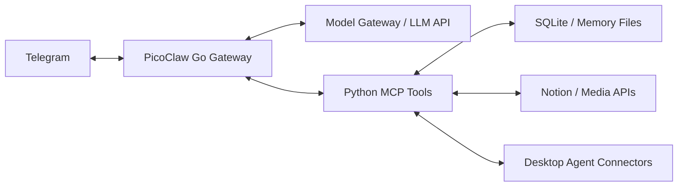

# Fatfish / 大肥鱼

简体中文 | [English](README.en.md)

Fatfish 是基于 [PicoClaw](https://github.com/sipeed/picoclaw) 构建的个人 AI 助手。它以 Telegram 为主要交互入口，把对话、记忆、待办、内容读取和编码 Agent 协作连接到一套可自行部署的运行环境中。

项目关注长期交流中的实际问题：接续真实聊天、保留可追溯的记忆、减少重复工具调用，并通过明确的执行回执区分“请求已返回”和“任务已完成”。

## 实现的功能

- **Telegram 交互**：支持私聊与群聊、文本和媒体发送、引用回复，以及基于本地接收和发送回执的状态查询。
- **对话上下文与记忆**：组合会话历史、较早对话摘要和长期记忆；支持历史压缩及原文归档。`chat_recall` 可以一次检索聊天原文、相关上下文和来源编号。
- **Notion 待办**：后台同步指定页面中的复选框和嵌套子任务，将未完成事项的简表注入个人私聊上下文；支持查看同步时间和按需刷新。
- **日记材料准备**：`diary_prepare` 按日期汇集聊天原文、阅读记录、已有日记和版本号，由模型整理表达，再通过版本化接口保存。
- **编码 Agent 协作**：通过连接器与 Codex、DSH 和 Claude Code 会话协作；`codex_overview` 汇总连接状态、进展快照、请求回执和最近额度。
- **内容与媒体**：提供 X、B 站和抖音的读取入口；Telegram 表情按类型发送为贴纸、图片或动画，本地表情库支持一次挑选、发送和记账。
- **工具按需发现**：MCP 工具可先通过搜索发现，再加载对应的工具定义；服务端也支持合并相互独立的读取操作。
- **提醒与后台维护**：支持提醒、静默闹钟和日记维护等能力，具体行为由部署配置及运行状态决定。

外部平台的可用功能取决于账号授权、接口和内容本身。例如，视频字幕或转写并非对所有链接都可用；编码 Agent 协作也需要相应连接器在线。

## 架构



Go 主程序负责消息通道、模型调用、上下文组装和工具调度；Python 工具服务提供记忆、待办、阅读和协作接口。模型网关与桌面连接器按部署需要配置。

## 项目结构

| 路径 | 内容 |
|---|---|
| `picoclaw/` | PicoClaw 源码及 Fatfish 的 Go 扩展 |
| `server-setup/` | Python 工具服务、模型网关、记忆和协作模块及测试 |
| `codex-control/` | 桌面编码 Agent 连接器及测试 |
| `x-reader/` | X 内容读取组件 |
| `workspace-tools/` | 表情挑选、发送和记账脚本 |
| `config/` | 不含实际凭据的配置样例 |
| `templates/` | 通用 Agent、操作指南和个人资料模板 |
| `deploy/systemd/` | Linux 服务单元模板 |
| `docs/` | 维护说明、源码来源和发布验收记录 |

## 构建与测试

Go 版本以 [`picoclaw/go.mod`](picoclaw/go.mod) 为准，目前为 **1.25.11**。Python 工具使用 Python 3；部分媒体和外部平台功能还需要各自的依赖、凭据或连接器。

在仓库根目录运行相关 Python 检查：

```sh
python3 server-setup/test-common-workflows.py
python3 server-setup/test-tool-efficiency.py
python3 workspace-tools/test_emotes.py
```

构建 Go 主程序并运行 Fatfish 相关检查：

```sh
cd picoclaw
go test -tags goolm,stdjson ./pkg/agent -run TestFatfish -count=1
mkdir -p ../build
go build -tags goolm,stdjson -o ../build/picoclaw ./cmd/picoclaw
```

## 配置与部署

这是从实际个人部署整理出的源码项目，并非一键安装的托管产品。部署前请阅读[维护说明](docs/OPERATIONS.md)，按自己的环境配置模型、Telegram、工具服务、Notion 和所需连接器；`config/` 与 `deploy/systemd/` 中的文件是起点，需要调整路径、服务账号和凭据位置。

仓库中的 SOUL、USER 文件是通用模板。实际个人资料、聊天记录、记忆数据库、令牌及其他部署私有数据应由部署环境单独保存。具体验收范围见[发布记录](docs/RELEASE-2026-11-04.md)，不能由源码存在推断所有外部服务均已在其他环境中验证。

## 致谢与许可

本项目基于 [sipeed/picoclaw](https://github.com/sipeed/picoclaw)，上游基线及源码来源见 [`docs/source-snapshot.json`](docs/source-snapshot.json)。仓库使用 [MIT 许可](LICENSE)；第三方组件的许可随各组件保留。
