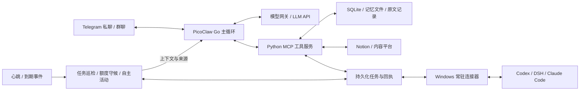

# Fatfish / 大肥鱼

简体中文 | [English](README.en.md)

## 这是什么

Fatfish 是基于 [PicoClaw](https://github.com/sipeed/picoclaw) 扩展的个人 AI 助手和聊天伙伴，以 Telegram 为主要入口。它把长期交流、记忆、主动分享和电脑上的编码 Agent 接在一起，由自己部署的服务器保存记录和安排活动。

## 解决哪些问题

- **长期聊天怎样接得上。** 对话原文持续保存，模型每轮读取近期交流和较早的摘要，需要时再查细节。这样能在有限上下文里接续交流，也能回查摘要的依据。
- **跨机器办事怎样知道进展。** 服务器把任务交给电脑上的 Codex、DSH 或 Claude Code，并保存执行回执和交付文件。任务完成与否由这些记录确认，减少反复追问和重复派单。
- **怎样主动，又能停下来。** 陪聊、自由活动、任务巡检和额度守候各有排程。程序提供行动机会，模型决定做什么，用户可以调整或取消安排。
- **后台忙时怎样先回应真人。** 真人消息优先，后台工作在合适的边界保存进展、交出执行位置。后台的内部结论留在记录里，需要联系用户时再显式发送。

## 整体怎么运作

Go 主程序负责接收消息、组织上下文、调用模型和调度工具。Python 服务提供记忆、待办、内容读取和任务记录，Windows 连接器让编码 Agent 使用电脑上已有的项目环境。

## 去哪里看细节

| 想了解什么 | 入口 |
|---|---|
| 设计原因、状态规则和功能细节 | [设计与实现](docs/DESIGN.md) |
| 构建、测试、配置与维护 | [维护说明](docs/OPERATIONS.md) |
| 实际部署版本、核对命令和回滚 | [线上现状](docs/DEPLOYED.md) |
| 上游基线和源码来源 | [源码快照](docs/source-snapshot.json) |

本项目使用 [MIT 许可](LICENSE)，第三方组件保留各自的许可。
